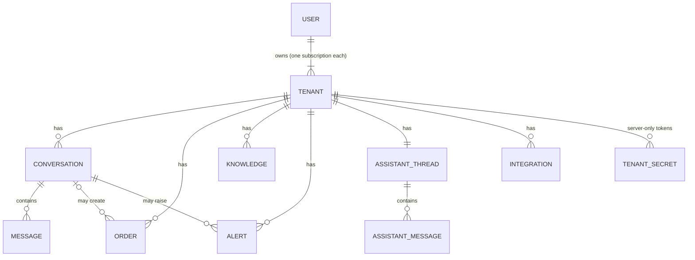
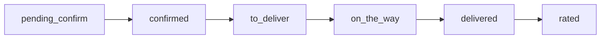
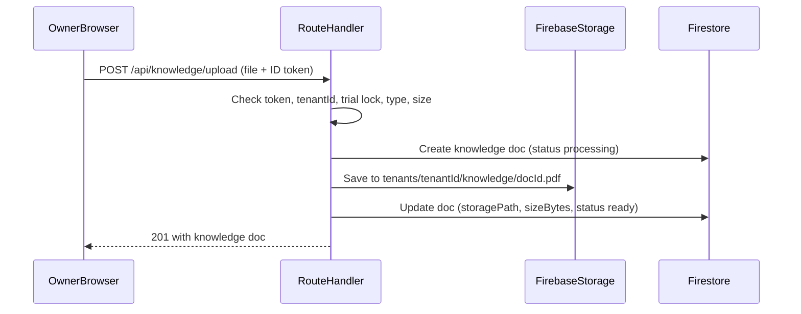
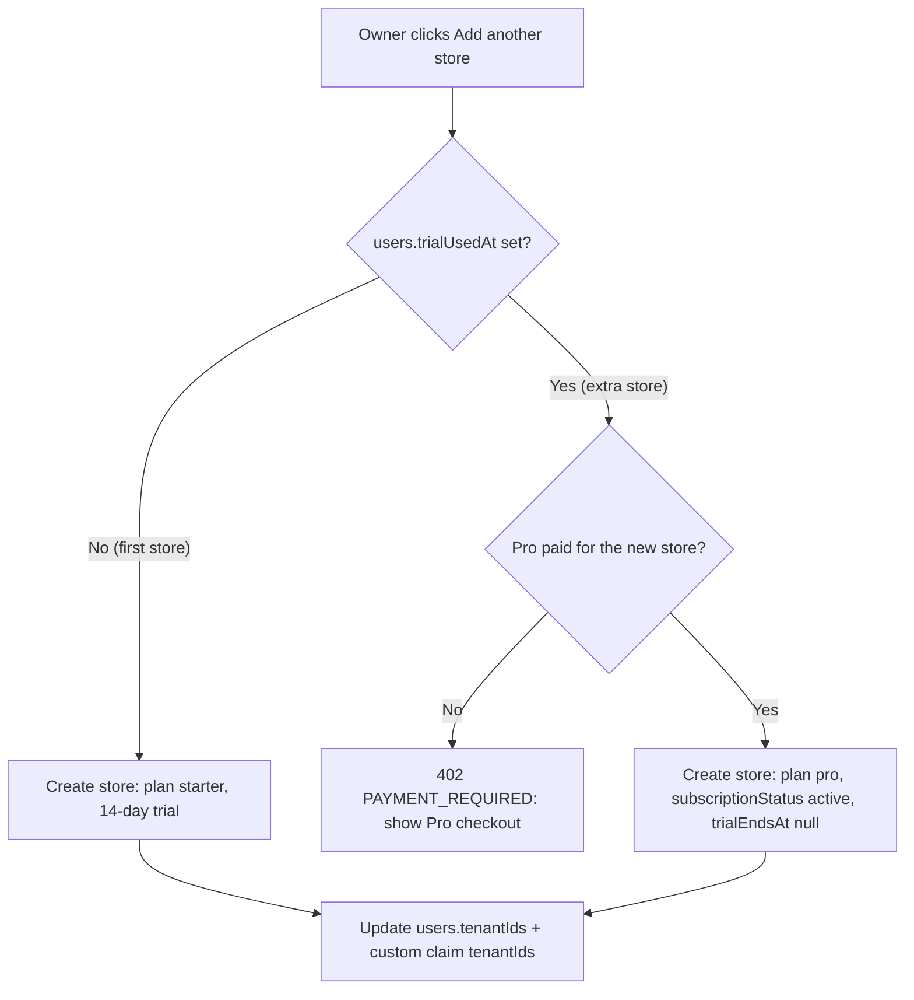

# InboxShelf — Backend Schema Document

| Field | Value |
|-------|--------|
| **Product** | InboxShelf |
| **Related** | [PRD](PRD.md) · [TRD](TRD.md) · [Design Brief](DESIGN_BRIEF.md) |
| **Stack** | Firebase Auth · Firestore · Firebase Storage · Next.js Route Handlers (Admin SDK) on Vercel |
| **Status** | Baseline for MVP implementation (dashboard is built later with the product) |

Three parts:

1. [Data Models](#1-data-models) — every Firestore collection and field
2. [Storage / Blob](#2-storage--blob) — which files we keep and where
3. [Access Control](#3-access-control) — who can read or change what

**Key decisions**

- **Only the store owner** can access a store’s dashboard. Each store has exactly one owner. No team members, staff, or shared logins.
- **One subscription per store.** An owner with two stores pays for two subscriptions. They use the **same login** and switch between stores in the dashboard.
- **One free trial per owner.** Only the owner’s first store gets the 14-day trial; every extra store is Pro ($10/mo) from day 1.
- **Shopify is separate from a normal website.** Orders carry `source: shopify | website | chat`; the website chat box is its own channel, `website_chat`.
- **All writes go through the server** (Route Handlers using the Firebase Admin SDK). The browser only reads its own store’s data.
- **Firestore is the source of truth.** Google Sheets is a synced copy, written only after the customer confirms on WhatsApp.

---

## 1. Data Models

### 1.1 Conventions

| Topic | Rule |
|-------|------|
| IDs | Firestore auto-IDs, except `users/{uid}` (Firebase Auth uid), `integrations/{provider}` (provider name), `assistantThreads/default` |
| Timestamps | Firestore `Timestamp`, server-set (`FieldValue.serverTimestamp()`) |
| Phone numbers | E.164 string, e.g. `+923001234567` |
| Money | Integer in the smallest unit (e.g. cents / paisa) + `currency` (ISO 4217, e.g. `PKR`, `USD`) |
| Enums | Lowercase strings with underscores, e.g. `on_the_way` |
| Optional fields | Stored as `null`, not omitted, once the document exists |
| Tenant scoping | Every product document lives under `tenants/{tenantId}/…` |

### 1.2 Relationship diagram



### 1.3 Collection map

```
tenants/{tenantId}
  conversations/{conversationId}
    messages/{messageId}
  orders/{orderId}
  knowledge/{docId}
  alerts/{alertId}
  assistantThreads/default
    messages/{messageId}
  integrations/{provider}

users/{uid}

tenantSecrets/{tenantId}
  tokens/{provider}
```

### 1.4 `tenants/{tenantId}` — one store = one subscription

| Field | Type | Required | Example | Notes |
|-------|------|----------|---------|-------|
| `name` | string | yes | `"North & Co."` | Store name from signup |
| `ownerUid` | string | yes | `"Xk3…9a"` | The only user allowed in this store |
| `plan` | `starter` \| `pro` | yes | `"starter"` | `starter` only for the owner’s first store (trial); extra stores start as `pro` |
| `trialEndsAt` | Timestamp \| null | yes | signup + 14 days | `null` for stores created without a trial |
| `subscriptionStatus` | `trialing` \| `active` \| `past_due` \| `canceled` \| `locked` | yes | `"trialing"` | This store’s own subscription |
| `billingRef` | string \| null | yes | `null` | Paddle subscription ID; `null` until billing is wired |
| `proSince` | Timestamp \| null | yes | `null` | Set when Pro is paid for this store |
| `shopUrl` | string \| null | yes | `"https://northco.pk"` | Store website |
| `orderLink` | string \| null | yes | `"https://northco.pk/order"` | Link the AI sends when a customer wants to buy |
| `storePlatform` | `shopify` \| `website` \| null | yes | `"shopify"` | Where the store’s site runs |
| `logoPath` | string \| null | yes | `"tenants/abc/branding/logo.png"` | See [Storage](#2-storage--blob) |
| `currency` | string | yes | `"PKR"` | Default for orders |
| `timezone` | string | yes | `"Asia/Karachi"` | For “today’s emails”, daily summaries |
| `createdAt` | Timestamp | yes | | |
| `updatedAt` | Timestamp | yes | | |

### 1.5 `users/{uid}` — the store owner

| Field | Type | Required | Example | Notes |
|-------|------|----------|---------|-------|
| `tenantIds` | string[] | yes | `["abc123", "def456"]` | All stores this owner owns (one subscription each) |
| `activeTenantId` | string | yes | `"abc123"` | Store opened last; the dashboard opens it by default |
| `trialUsedAt` | Timestamp \| null | yes | first signup | Set when the first store starts its trial; blocks a second trial |
| `email` | string | yes | `"owner@northco.pk"` | |
| `displayName` | string \| null | yes | `"Ayesha Khan"` | From Google or signup |
| `role` | `owner` | yes | `"owner"` | The only role in InboxShelf |
| `authProvider` | `password` \| `google` | yes | `"google"` | |
| `createdAt` | Timestamp | yes | | |
| `lastLoginAt` | Timestamp \| null | yes | | |

### 1.6 `tenants/{tenantId}/conversations/{conversationId}` — one customer chat

| Field | Type | Required | Example | Notes |
|-------|------|----------|---------|-------|
| `channel` | `whatsapp` \| `instagram` \| `messenger` \| `website_chat` | yes | `"instagram"` | `website_chat` = chat box on the store’s site |
| `externalThreadId` | string | yes | `"t_10223…"` | Thread / sender ID from the channel |
| `customerName` | string \| null | yes | `"Omar"` | |
| `customerPhone` | string \| null | yes | `"+923001234567"` | E.164; may be unknown on IG / Messenger |
| `customerHandle` | string \| null | yes | `"@omar.shop"` | IG / Messenger handle |
| `mode` | `ai_on` \| `paused` \| `human_takeover` | yes | `"ai_on"` | Owner can send only when `paused` / `human_takeover` |
| `language` | string \| null | yes | `"ur"` | Auto-detected (BCP 47) |
| `lastMessageAt` | Timestamp | yes | | Inbox sort key |
| `lastMessagePreview` | string | yes | `"Can you deliver to Lahore?"` | Max 120 chars |
| `unreadCount` | number | yes | `2` | |
| `createdAt` | Timestamp | yes | | |

**Key:** one conversation per `channel` + `externalThreadId` per tenant.

### 1.7 `…/conversations/{conversationId}/messages/{messageId}` — one chat message

| Field | Type | Required | Example | Notes |
|-------|------|----------|---------|-------|
| `role` | `customer` \| `ai` \| `human` \| `system` | yes | `"ai"` | `human` = owner reply |
| `text` | string | yes | `"Yes — size M is in stock."` | |
| `channelMessageId` | string \| null | yes | `"wamid.HBg…"` | ID from WhatsApp / Meta |
| `deliveryStatus` | `queued` \| `sent` \| `delivered` \| `read` \| `failed` \| null | yes | `"delivered"` | Outgoing messages only |
| `mediaRef` | map \| null | yes | `{ "type": "image", "channelMediaId": "…" }` | Link/ID only — media itself is not stored |
| `createdAt` | Timestamp | yes | | |

### 1.8 `tenants/{tenantId}/orders/{orderId}` — one order

| Field | Type | Required | Example | Notes |
|-------|------|----------|---------|-------|
| `source` | `shopify` \| `website` \| `chat` | yes | `"shopify"` | **Shopify and a normal website are separate sources** |
| `externalId` | string \| null | yes | `"#1043"` | Shopify / website order number; `null` for chat orders |
| `conversationId` | string \| null | yes | | Chat the order came from, if any |
| `customerName` | string | yes | `"Sara Ahmed"` | |
| `customerPhone` | string | yes | `"+923001234567"` | **WhatsApp number used for confirm + delivery messages** |
| `location` | string | yes | `"Lahore — DHA Phase 5"` | City / area (required by PRD §5.2) |
| `address` | string \| null | yes | `"House 12, Street 4"` | |
| `items` | array of `{ name: string, qty: number, unitPrice: number }` | yes | `[{ "name": "Linen shirt M", "qty": 1, "unitPrice": 450000 }]` | `unitPrice` in smallest unit |
| `total` | number | yes | `450000` | Smallest unit |
| `currency` | string | yes | `"PKR"` | |
| `status` | see below | yes | `"pending_confirm"` | |
| `confirmedAt` | Timestamp \| null | yes | | Set when the customer says “yes” on WhatsApp |
| `sheetsRowRef` | string \| null | yes | `"Orders!A42"` | Set after the Sheets write |
| `sheetsSyncedAt` | Timestamp \| null | yes | | |
| `rating` | number (1–5) \| null | yes | `5` | Asked in chat after delivery |
| `reviewLinkSentAt` | Timestamp \| null | yes | | Optional site review link |
| `dedupeKey` | string | yes | `"+923001234567:shopify:#1043"` | See rules below |
| `createdAt` | Timestamp | yes | | |
| `updatedAt` | Timestamp | yes | | |

**Status flow** (only these moves are allowed):



**Order rules**

- **Dedupe:** `dedupeKey` = normalised phone + source + order identity (`externalId`, or a hash of items + day for chat orders). A write with an existing `dedupeKey` updates that order instead of creating a new one — so the same order arriving from Shopify and from chat becomes one row.
- **Sheets:** the Google Sheets row is written **only after** `status` becomes `confirmed` (customer said “yes” on WhatsApp). Never before.
- **Delivery message:** moving to `on_the_way` (owner tick in Sheets or Orders) sends the WhatsApp “on the way” message to `customerPhone`.

### 1.9 `tenants/{tenantId}/knowledge/{docId}` — FAQ or PDF

| Field | Type | Required | Example | Notes |
|-------|------|----------|---------|-------|
| `type` | `faq` \| `pdf` | yes | `"pdf"` | |
| `title` | string | yes | `"Size chart 2026"` | |
| `text` | string \| null | yes | `"We ship in 3–5 days…"` | FAQ text; `null` for PDFs |
| `storagePath` | string \| null | yes | `"tenants/abc/knowledge/d1.pdf"` | PDFs only |
| `sizeBytes` | number \| null | yes | `482113` | |
| `contentType` | string \| null | yes | `"application/pdf"` | |
| `status` | `processing` \| `ready` \| `failed` | yes | `"ready"` | `ready` = usable by the AI |
| `createdAt` | Timestamp | yes | | |

*Later (when AI goes live):* `knowledge/{docId}/chunks/{chunkId}` with `text`, `embedding`, `order` for RAG.

### 1.10 `tenants/{tenantId}/alerts/{alertId}` — stuck chat / handover

| Field | Type | Required | Example | Notes |
|-------|------|----------|---------|-------|
| `type` | `handover` \| `stuck` | yes | `"stuck"` | |
| `conversationId` | string | yes | | The paused chat |
| `reason` | string | yes | `"Question not in knowledge"` | |
| `channelsNotified` | array of `whatsapp` \| `email` \| `dashboard` | yes | `["whatsapp","email","dashboard"]` | |
| `createdAt` | Timestamp | yes | | |
| `ackedAt` | Timestamp \| null | yes | `null` | Set when the owner acknowledges |

### 1.11 `tenants/{tenantId}/assistantThreads/default/messages/{messageId}` — owner Assistant

| Field | Type | Required | Example | Notes |
|-------|------|----------|---------|-------|
| `role` | `owner` \| `bot` | yes | `"owner"` | Never contains customer messages |
| `text` | string | yes | `"List my important emails today"` | |
| `intent` | string \| null | yes | `"list_important_emails"` | Bot replies only |
| `result` | map \| null | yes | `{ "emails": [...] }` | Structured result shown in the thread |
| `createdAt` | Timestamp | yes | | |

### 1.12 `tenants/{tenantId}/integrations/{provider}` — connection status

`{provider}` is one of:

| Provider | What it connects |
|----------|------------------|
| `whatsapp` | WhatsApp Business (Cloud API) |
| `instagram` | Instagram DM |
| `messenger` | Facebook Messenger |
| `website_chat` | Chat box script on the store’s website |
| `shopify` | Orders from a **Shopify** store |
| `website_orders` | Orders from a **non-Shopify** website (WordPress, custom) via webhook |
| `google_sheets` | Order sheet sync |
| `gmail` | Important mail |
| `outlook` | Important mail |

| Field | Type | Required | Example | Notes |
|-------|------|----------|---------|-------|
| `status` | `disconnected` \| `connected` \| `mock` \| `error` | yes | `"connected"` | `mock` until `LIVE_*` flags are on |
| `displayName` | string \| null | yes | `"northco.myshopify.com"` | What the owner sees |
| `config` | map | yes | `{ "sheetId": "1Ab…", "phoneNumberId": "1098…" }` | **Non-secret** settings only |
| `connectedAt` | Timestamp \| null | yes | | |
| `lastErrorAt` | Timestamp \| null | yes | | |
| `updatedAt` | Timestamp | yes | | |

### 1.13 `tenantSecrets/{tenantId}/tokens/{provider}` — server-only

| Field | Type | Required | Notes |
|-------|------|----------|-------|
| `accessToken` | string | yes | Encrypted at rest by the app before saving |
| `refreshToken` | string \| null | yes | Gmail / Outlook / Sheets |
| `webhookSecret` | string \| null | yes | Shopify / `website_orders` signing secret |
| `expiresAt` | Timestamp \| null | yes | |
| `updatedAt` | Timestamp | yes | |

Kept outside `tenants/` so no client rule can ever expose it. Read and written by the server only (see [Access Control](#3-access-control)).

### 1.14 Indexes (Firestore composite)

| Collection | Fields | Used for |
|------------|--------|----------|
| `conversations` | `mode` ASC, `lastMessageAt` DESC | Inbox filtered by mode |
| `orders` | `status` ASC, `createdAt` DESC | Orders page by status |
| `orders` | `dedupeKey` ASC | Dedupe lookup on write |
| `orders` | `source` ASC, `createdAt` DESC | Filter Shopify / website / chat |
| `alerts` | `ackedAt` ASC, `createdAt` DESC | Open alerts first |

Single-field sorts (`lastMessageAt`, `createdAt`) use Firestore’s automatic indexes.

---

## 2. Storage / Blob

Firebase Storage, one bucket. Every file lives under its store’s folder.

### 2.1 What we store

| File | Path | Allowed types | Max size |
|------|------|---------------|----------|
| Knowledge PDF | `tenants/{tenantId}/knowledge/{docId}.pdf` | `application/pdf` | 10 MB |
| Store logo | `tenants/{tenantId}/branding/logo.{png\|webp\|svg}` | `image/png`, `image/webp`, `image/svg+xml` | 1 MB |

### 2.2 What we do **not** store

- **Customer chat media** (photos, voice notes, videos from WhatsApp / Instagram / Messenger). Only the channel’s media ID / link is saved in `messages.mediaRef`; the file stays with the channel.
- Email attachments (Gmail / Outlook stay the source).
- Payment cards or any payment details (Pro billing is handled by the payment provider later).

### 2.3 Upload flow



- The browser **never writes** to Storage directly; the API validates type and size first.
- Logo upload follows the same pattern via `POST /api/tenants/logo` and replaces the previous file.

### 2.4 Downloads

- The owner’s browser may **read** files in its own store folder (rules below), e.g. to preview a PDF or show the logo.
- The server reads PDFs with the Admin SDK for AI / RAG processing.

### 2.5 Deletion

| Event | What happens |
|-------|--------------|
| Knowledge doc deleted | Its PDF is deleted from Storage in the same API call |
| Logo replaced | Old logo file deleted |
| Store (tenant) deleted | Whole `tenants/{tenantId}/` folder deleted, plus the Firestore tenant tree and `tenantSecrets/{tenantId}` |
| Failed upload (`status: failed`) | File removed; doc kept with `failed` so the owner sees the error |

---

## 3. Access Control

### 3.1 Who can access what

| Who | How they reach InboxShelf | Access |
|-----|---------------------------|--------|
| **Store owner** | Logs in at `/login` (email + password or Google) | **Only the stores they own.** The only dashboard user. |
| **Customers** | WhatsApp, Instagram, Messenger, website chat box | **Never log in.** They only reach the AI through channels / webhooks. |
| **Shopify / website / Meta** | Webhooks | Write events through signed webhook endpoints only |
| **SaaS operator (us)** | Firebase console + Vercel | Not through the app; no admin login in the product |

**Owner-only rule:** each store has exactly one owner (`tenants.ownerUid`). One owner may own several stores (`users.tenantIds`), and **each store is its own subscription**. There are no team members, staff accounts, invites, or shared logins — now or as a Pro feature.

### 3.2 How the owner is identified

1. Owner signs up → Firebase Auth creates the account.
2. `POST /api/tenants` (server) creates `tenants/{tenantId}` and `users/{uid}`, adds the store to `users.tenantIds`, then sets the **custom claim** `tenantIds` (list of owned stores) on the Firebase user.
3. Every later request sends the Firebase ID token **and** an `X-Tenant-Id` header naming the store currently open.
4. The server verifies the token and checks that `X-Tenant-Id` is in the token’s `tenantIds`. If not → `403`.
5. Switching stores in the dashboard only changes `X-Tenant-Id` (and saves `users.activeTenantId`); no new login is needed.

### 3.3 Adding another store



- The first store is created at signup with the free trial and sets `users.trialUsedAt`.
- Every extra store needs its own Pro payment **before** it is created (no second trial, no card-free store).
- After the claim is updated, the client refreshes its ID token so the new store is readable.

### 3.4 Permission table

| Data | Owner’s browser (Firebase client) | Server API (Admin SDK) | Webhooks |
|------|-----------------------------------|------------------------|----------|
| `tenants/{tenantId}` | Read stores they own | Read / write | — |
| `users/{uid}` | Read own | Read / write | — |
| `conversations`, `messages` | Read own store | Read / write | Meta + website chat: create via API |
| `orders` | Read own store | Read / write | Shopify + website orders: create / update via API |
| `knowledge` | Read own store | Read / write | — |
| `alerts` | Read own store | Read / write | — |
| `assistantThreads` | Read own store | Read / write | — |
| `integrations` | Read own store | Read / write | — |
| `tenantSecrets` | **No access** | Read / write | — |
| Storage `tenants/{tenantId}/…` | Read own | Read / write | — |

**Every write goes through the server**, so business rules (status flow, dedupe, Sheets-after-confirm, trial lock) cannot be skipped from the browser.

### 3.5 Firestore rules (sketch)

```
rules_version = '2';
service cloud.firestore {
  match /databases/{database}/documents {
    function ownsTenant(tenantId) {
      return request.auth != null && tenantId in request.auth.token.tenantIds;
    }

    match /tenants/{tenantId} {
      allow read: if ownsTenant(tenantId);
      allow write: if false;

      match /{document=**} {
        allow read: if ownsTenant(tenantId);
        allow write: if false;
      }
    }

    match /users/{uid} {
      allow read: if request.auth != null && request.auth.uid == uid;
      allow write: if false;
    }

    match /tenantSecrets/{document=**} {
      allow read, write: if false;
    }
  }
}
```

The Admin SDK on the server bypasses these rules; that is where all writes happen.

### 3.6 Storage rules (sketch)

```
rules_version = '2';
service firebase.storage {
  match /b/{bucket}/o {
    match /tenants/{tenantId}/{allPaths=**} {
      allow read: if request.auth != null && tenantId in request.auth.token.tenantIds;
      allow write: if false;
    }
  }
}
```

### 3.7 API checks on every request

| Step | Check | Fail response |
|------|-------|---------------|
| 1 | Valid Firebase ID token | `401 UNAUTHENTICATED` |
| 2 | `X-Tenant-Id` header is in the token’s `tenantIds` | `403 FORBIDDEN` |
| 3 | **Per-store** lock: that store has `subscriptionStatus == active` (Pro paid) **or** (`trialing` and `now < trialEndsAt`) | `402 TRIAL_EXPIRED` / `402 PAYMENT_REQUIRED` (dashboard shows paywall for that store) |
| 4 | Body valid (Zod) | `400 VALIDATION_ERROR` |
| 5 | Business rule (e.g. legal status move, composer only when `paused` / `human_takeover`) | `409 CONFLICT` |

Errors use the TRD envelope: `{ error: { code, message, requestId } }`. A locked store does not lock the owner’s other stores. The owner can still log in, switch stores, see the paywall, and upgrade the locked one.

### 3.8 Webhook checks

| Endpoint | Source | Verification |
|----------|--------|--------------|
| `POST /api/webhooks/meta` | WhatsApp / Instagram / Messenger | `X-Hub-Signature-256` HMAC with the Meta app secret |
| `POST /api/webhooks/shopify` | Shopify store | `X-Shopify-Hmac-Sha256` with the store’s webhook secret |
| `POST /api/webhooks/website` | Non-Shopify website orders | `X-InboxShelf-Signature` HMAC with the tenant’s `website_orders` secret |
| `POST /api/widget/messages` | Website chat box | Public tenant widget key + origin check against `shopUrl`; rate-limited |

Unsigned or wrongly signed requests → `401`, logged, and ignored. Webhooks find the tenant from the integration config (e.g. Shopify shop domain, WhatsApp phone number ID), never from the request body alone.

### 3.9 Secrets

| Secret | Where it lives |
|--------|----------------|
| Firebase Admin key, Meta app secret, OpenAI key, Resend key | Vercel server environment variables |
| Per-store OAuth tokens and webhook secrets | `tenantSecrets/{tenantId}/tokens/{provider}` (server-only, encrypted) |
| Firebase web config (`NEXT_PUBLIC_FIREBASE_*`) | Client — public by design, protected by the rules above |

Never put secrets in `tenants/…` documents, `integrations.config`, logs, or `.env*` files committed to Git.
