# InboxShelf — Implementation Plan

| Field | Value |
|-------|--------|
| **Product** | InboxShelf |
| **Purpose** | Build order for the whole product — what to ship in each phase and when a phase is done |
| **Related** | [PRD](PRD.md) · [TRD](TRD.md) · [Backend Schema](BACKEND_SCHEMA.md) · [Design Brief](DESIGN_BRIEF.md) |
| **Status** | Baseline for product build (marketing site exists; dashboard and APIs come in these phases) |
| **Payments** | **Paddle** (Pro $10/mo per store). Stripe is not used — seller is in Pakistan |

This plan covers the **whole product** in build order. Four modules called out by name:

- **Auth + Gmail** — Google login and connect Gmail for important emails (Phase P1; mail list continues in P8)
- **Transcribe** — voice notes → text for the AI (Phase P5)
- **Clipping** — save important chats/messages to the shelf (Phase P7)
- **Paid Plans** — Paddle checkout and per-store subscriptions (Phase P9)

---

## Locked rules (every phase)

- **One subscription per store.** Two stores = two subscriptions. Same login; store switcher in the dashboard.
- **One free trial per owner.** Only the first store gets 14 days free (no card). Extra stores need Pro paid via Paddle before create.
- **Owner only.** No staff or shared logins. Server checks `tenantIds` and `X-Tenant-Id`.
- **Voice media stays on the channel.** Transcribe stores **text** on the message, not the audio file in Firebase Storage.
- **Clipping** stores a reference + optional text snippet — not a copy of chat media.
- **Writes go through Route Handlers** (Firebase Admin). Client reads its own store only.
- Live integrations stay behind env flags (`LIVE_META`, `LIVE_SHEETS`, `LIVE_MAIL`, etc.) until credentials are ready. See TRD §7.2.

```mermaid
flowchart LR
  P0[P0 Foundation] --> P1[P1 Auth Gmail]
  P1 --> P2[P2 Dashboard shell]
  P2 --> P3[P3 Knowledge AI]
  P3 --> P4[P4 Channels inbox]
  P4 --> P5[P5 Transcribe]
  P5 --> P6[P6 Orders Sheets]
  P6 --> P7[P7 Clipping]
  P7 --> P8[P8 Assistant mail]
  P8 --> P9[P9 Paddle plans]
  P9 --> P10[P10 Polish Pro]
```



| Phase | Focus | Done when |
|-------|--------|-----------|
| **P0** | Env, Firebase Admin, API auth helpers, logging | Server can verify ID tokens |
| **P1** | Auth + Gmail enable | Real signup/login; Gmail connect UX + list API (flagged) |
| **P2** | Dashboard shell, store switcher, trial lock UI | Owner opens dashboard for active store |
| **P3** | Knowledge upload + AI from knowledge only | FAQ/PDF → grounded answers |
| **P4** | Meta channels + unified inbox + handover | WA/IG/Messenger/website chat stub→live |
| **P5** | Transcribe voice notes | Voice notes become text before AI reply |
| **P6** | Shopify + website orders + Sheets + WA confirm | Order lifecycle matches PRD |
| **P7** | Clipping module | Save, list, unclip APIs + UI |
| **P8** | Assistant + Outlook + mail intents | Ops questions in private thread |
| **P9** | Paddle paid plans | Trial lock + add-store uses Paddle |
| **P10** | Analytics, TikTok later, white-label flags | Pro modules behind flags |

---

## P0 — Foundation

**Goal:** Shared server pieces every later phase needs.

**Builds on:** Marketing site already live (landing, login/signup UI, design system).

**Main tasks**

- Firebase Admin SDK on Vercel (service account / env secrets)
- `verifyIdToken` helper; attach `uid` + `tenantIds` from custom claims
- Structured logging (`requestId`) and shared JSON error envelope (TRD §10)
- Env template for Firebase, Resend, OpenAI, Meta, Paddle (values empty until needed)

**APIs / collections**

- No product routes yet — helpers under `src/lib/` (or equivalent)

**Acceptance**

- [ ] A protected Route Handler rejects missing/invalid tokens with `401`
- [ ] Logs include `requestId` on failure

---

## P1 — Auth Module (Gmail enable)

**Goal:** Owners can sign up and log in for real; first store gets the trial; owners can connect Gmail so InboxShelf can show important emails.

Two parts in this phase:

1. **Google login** — “Sign up with Google” / “Continue with Google” (plus email + password)
2. **Gmail connect** — OAuth to the owner’s Gmail inbox for important-mail listing

**Builds on:** P0; login/signup pages already designed.

**Main tasks**

- Wire Firebase Auth (Email/Password + Google provider) on client
- On first signup: create `tenants/{id}`, set `subscriptionStatus=trialing`, `trialEndsAt`, `plan=starter`; set `users.tenantIds`, `activeTenantId`, `trialUsedAt`
- Set custom claim `tenantIds` on create/add store
- Dashboard redirect after login to `activeTenantId`
- Gmail OAuth connect on Integrations; store tokens in `tenantSecrets/.../tokens/gmail` (server only)
- Important-mail list API behind `LIVE_MAIL` (mock list until flag is on)
- Resend for system mail (welcome / stuck-chat alerts later)

**APIs / collections**

- `POST /api/tenants` (first store only without payment)
- `GET /api/tenants`, `GET /api/tenants/me` (`X-Tenant-Id`)
- `POST /api/integrations/gmail/connect` (or OAuth callback route)
- `GET /api/email/important` (flagged)
- Collections: `users`, `tenants`, `integrations/gmail`, `tenantSecrets`

**Acceptance**

- [ ] Email/password and Google signup create a tenant and open the dashboard
- [ ] Login returns the owner to `activeTenantId`
- [ ] Gmail Connect stores tokens server-side only; list endpoint returns mock or live mail per flag
- [ ] Signup never asks for a card (first store)

---

## P2 — Dashboard shell

**Goal:** Owner-only product shell with store context and paywall-ready UI.

**Builds on:** P1.

**Main tasks**

- Routes: `/dashboard`, inbox entry, orders, email, knowledge, integrations, alerts (TRD §3.2)
- Store switcher when `tenantIds.length > 1`; persist `activeTenantId`
- Send `X-Tenant-Id` on every dashboard API call
- Trial / lock banner UI (full lock behavior wired in P9 with Paddle)
- “Add another store” entry point (create path completes in P9 when payment is required)

**Acceptance**

- [ ] Owner sees only their store’s shell; wrong `X-Tenant-Id` → `403`
- [ ] Switching store updates `activeTenantId` and reloads data for that store

---

## P3 — Knowledge + AI replies

**Goal:** AI answers product questions only from uploaded FAQs and PDFs.

**Builds on:** P2.

**Main tasks**

- Knowledge upload (PDF ≤ 10 MB) to Storage; metadata in `knowledge`
- FAQ text entries
- Internal AI reply path: retrieve from knowledge → reply or escalate when unsure
- No invented stock or prices (PRD §5.2)

**APIs / collections**

- Knowledge CRUD + upload; `/api/internal/ai-reply` (or equivalent)
- `knowledge/{docId}`; Storage `tenants/{tenantId}/knowledge/...`

**Acceptance**

- [ ] Uploaded PDF is readable for retrieval
- [ ] Out-of-knowledge questions do not invent facts; handover path can trigger later (P4)

---

## P4 — Channels + unified inbox + handover

**Goal:** One inbox for WhatsApp, Instagram, Messenger, and website chat; stuck chats pause and alert the owner.

**Builds on:** P3.

**Main tasks**

- Meta webhook stub → live behind `LIVE_META`
- Website chat widget message API (`/api/widget/messages`) with origin check
- Conversations + messages under the tenant; composer modes (AI / human)
- Stuck → alert (dashboard + Resend; owner WhatsApp later); pause **that** thread only
- Owner can type a human reply on a stuck thread

**APIs / collections**

- `/api/webhooks/meta`, conversations/messages APIs, alerts
- `conversations`, `messages`, `alerts`, `integrations` for channel providers

**Acceptance**

- [ ] Inbound stub/live messages appear in the inbox
- [ ] Stuck thread unlocks composer for the owner; other chats keep AI on

---

## P5 — Transcribe Module

**Goal:** Turn customer voice notes (WhatsApp, Instagram, Messenger) into text so the AI can read and reply.

**Builds on:** P4 (messages with `mediaRef`).

**Main tasks**

- Detect voice / audio inbound messages
- Fetch media from the channel using stored `mediaRef` (temporary download; **do not** keep audio in Firebase Storage)
- Speech-to-text provider (env-keyed); write result onto the message
- AI reply pipeline waits for transcript (or skips with escalate if transcription fails)
- Show transcript in the inbox UI under the voice bubble

**Schema note** (update [Backend Schema](BACKEND_SCHEMA.md) when implementing):

| Field on `messages/{id}` | Type | Notes |
|--------------------------|------|--------|
| `mediaRef` | string \| null | Channel media id/url (already planned) |
| `mediaKind` | `voice` \| `image` \| … \| null | Optional classifier |
| `transcript` | string \| null | Speech-to-text result |
| `transcriptionStatus` | `pending` \| `ready` \| `failed` \| null | Pipeline state |

**APIs**

- Internal job or webhook step: `transcribeMessage(tenantId, conversationId, messageId)`
- No public upload of voice files

**Acceptance**

- [ ] Voice note → `transcriptionStatus=ready` and `transcript` filled
- [ ] AI can reply using transcript text
- [ ] Audio is not stored long-term in Firebase Storage

---

## P6 — Orders + Google Sheets

**Goal:** Shopify, website, and chat orders follow the confirm-on-WhatsApp → Sheets lifecycle.

**Builds on:** P4–P5.

**Main tasks**

- Shopify webhook (`source: shopify`) and website order webhook (`source: website`)
- Chat order flow: site link → WA confirm on order phone → write Firestore + Sheets only after **yes**
- Dedupe rules; location on the row
- Delivery ticks → on-the-way WhatsApp; rating 1–5
- Flags: `LIVE_SHOPIFY`, `LIVE_WEBSITE_ORDERS`, `LIVE_SHEETS`

**APIs / collections**

- `/api/webhooks/shopify`, `/api/webhooks/website`, orders status APIs
- `orders`, Sheets sync side effect

**Acceptance**

- [ ] Sheets row never written before WhatsApp confirm (chat path)
- [ ] Shopify and website sources stay distinct from `website_chat`

---

## P7 — Clipping Module

**Goal:** Owner can save (“clip”) important customer chats or messages to the shelf and find them later.

**Builds on:** P4 inbox.

**Main tasks**

- Clip a message or an entire conversation from the inbox
- Clipped shelf list (filter/search by channel, date, customer)
- Unclip / remove from shelf
- Optional note on the clip

**Schema note** (update Backend Schema when implementing):

```
tenants/{tenantId}/clips/{clipId}
```

| Field | Type | Notes |
|-------|------|--------|
| `conversationId` | string | Required |
| `messageId` | string \| null | Null = whole conversation clip |
| `snippet` | string \| null | Short text preview (from message or transcript) |
| `channel` | string | Copied for list UI |
| `customerName` | string \| null | Denormalized for search |
| `note` | string \| null | Owner note |
| `createdAt` | Timestamp | |
| `createdBy` | string | `uid` of owner |

**APIs**

- `POST /api/clips`, `GET /api/clips`, `DELETE /api/clips/{clipId}`

**Acceptance**

- [ ] Owner can clip and see the item on the shelf
- [ ] Unclip removes it; original chat unchanged
- [ ] No media files duplicated into Storage for clips

---

## P8 — Assistant + mail intents

**Goal:** Private ops Assistant; Gmail (from P1) plus Outlook; intents like “list important emails today”.

**Builds on:** P1 Gmail, P6 orders, P4 alerts.

**Main tasks**

- Assistant thread API (owner only; never posts to customer channels)
- Outlook connect (same pattern as Gmail) behind `LIVE_MAIL`
- Intent stubs → live: important emails, orders on the way, stuck chats
- Email page lists important mail from connected boxes

**APIs / collections**

- `/api/assistant/messages`
- `assistantThreads/default/messages`, mail integrations

**Acceptance**

- [ ] Assistant answers stay in the Assistant thread
- [ ] “List my important emails today” returns connected-box items when live

---

## P9 — Plans / Paid Plans (Paddle)

**Goal:** Pro billing with **Paddle** — one subscription per store; extra stores pay first.

**Builds on:** P1 trial fields, P2 lock UI.

**Main tasks**

- Paddle product/price for Pro **$10/mo per store**
- Checkout for: (a) first store after trial, (b) add another store before create
- Webhooks: subscription created / updated / canceled / past_due → update `tenants.subscriptionStatus`, `plan`, `billingRef`
- Per-store lock: `trialing` until `trialEndsAt`; then `locked` until `active`; locked store does **not** lock other stores
- `POST /api/tenants` for 2nd+ store: if `users.trialUsedAt` set and no paid checkout → `402 PAYMENT_REQUIRED`
- Customer portal link (Paddle) for manage/cancel

**Env**

- `PADDLE_API_KEY`, `PADDLE_WEBHOOK_SECRET`, `PADDLE_PRICE_ID_PRO` (names may match Paddle’s dashboard)

**APIs**

- `POST /api/billing/checkout` (tenant or “new store” intent)
- `POST /api/webhooks/paddle`
- Existing tenant create gates

**Acceptance**

- [ ] After trial, unpaid store is locked; Paddle checkout restores `active`
- [ ] Second store requires successful Pro payment before tenant create
- [ ] `billingRef` stores Paddle subscription id; cards never touch our DB

---

## P10 — Polish / Pro modules

**Goal:** Later Pro features behind flags (same deploy).

**Builds on:** P9.

**Main tasks**

- Higher chat/AI limits by plan
- Sales / reply-rate analytics
- TikTok messaging (when ready)
- Extra sheets and mailboxes (per store) — not “multi-store” (stores are separate subscriptions)
- White-label / custom domain
- Priority support packaging

**Acceptance**

- [ ] `pro_*` flags gate UI and API without a separate app

---

## Suggested schema follow-ups

When coding P5 and P7, extend [BACKEND_SCHEMA.md](BACKEND_SCHEMA.md) with:

1. Message transcription fields (`transcript`, `transcriptionStatus`, optional `mediaKind`)
2. `clips` collection under each tenant
3. `billingRef` documented as **Paddle** subscription id

TRD §13 short phase table is superseded by **this document** for build order.

---

## Definition of done (product MVP)

Ship through **P9** for a sellable core:

- [ ] Real Auth (email/password + Google) + Gmail connect
- [ ] Dashboard shell + store switcher + per-store trial/Pro lock via Paddle
- [ ] Knowledge-grounded AI + channels inbox + handover
- [ ] Transcribe on voice notes
- [ ] Orders + Sheets lifecycle
- [ ] Clipping shelf
- [ ] Assistant + important mail
- [ ] One subscription per store; one trial per owner
