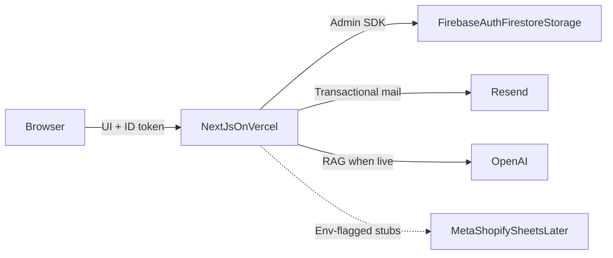

# InboxShelf — Technical Requirements Document (TRD)

| Field | Value |
|-------|--------|
| **Product** | InboxShelf |
| **Related PRD** | [docs/PRD.md](PRD.md) |
| **Version** | 1.0 |
| **Status** | Baseline for MVP implementation |
| **Primary URL** | https://inboxshelf.com |
| **Secondary URL** | https://inboxshelf.ai → redirect to `.com` |

### Assumptions (locked for this deliverable)

Teacher-mandated stack overrides older PRD Postgres notes:

- Firebase Auth + Firestore + Storage are the system of record (no PostgreSQL/Prisma).
- Node.js backend = Next.js App Router **Route Handlers** on Vercel (single deploy).
- Resend covers transactional/system email; Gmail/Outlook inbox triage remains product-scoped (mock → live later).
- Logging, error handling, and unit testing form one graded quality block (~7 marks) — see §10.

---

## 1. Stack summary

| Layer | Choice |
|-------|--------|
| Frontend | TypeScript, Next.js App Router, React, Tailwind CSS |
| Backend | Node.js via Next.js Route Handlers (`src/app/api/**`) |
| Database | Firebase Firestore |
| Auth | Firebase Authentication (email/password + Google) |
| File storage | Firebase Storage (FAQ PDFs / knowledge uploads) |
| Email (system) | Resend |
| AI | OpenAI/Anthropic + RAG (mock replies first; live behind env flags) |
| Hosting | Vercel |
| VCS | Git |
| DNS | Custom domain A/CNAME → Vercel |
| Mode | **Mock/demo first**; real channel APIs behind env flags |

---

## 2. System architecture



**Flow**

1. Owner loads marketing or dashboard from Vercel.
2. Client signs in with Firebase Auth; API calls send the Firebase ID token.
3. Route Handlers verify the token, enforce tenant scope, read/write Firestore/Storage.
4. System emails (signup notice, handover alert) go through Resend.
5. Channel webhooks (WhatsApp, Shopify, Sheets, Gmail) are stubbed until live flags are on.

---

## 3. Frontend (Next.js)

### 3.1 Public routes

| Route | Purpose |
|-------|---------|
| `/` | Marketing landing (features, workflow, pricing `#pricing`) |
| `/login` | Owner login |
| `/signup` | Tenant + owner signup |
| `/pricing` | Redirect to `/#pricing` |

### 3.2 Dashboard routes (product surfaces)

| Route | Purpose |
|-------|---------|
| `/dashboard` | Overview / inbox entry |
| `/dashboard` inbox (or `/dashboard/email` sibling pattern) | Unified customer inbox |
| `/dashboard/orders` | Orders + status ticks |
| `/dashboard/email` | Important mail list (mock → OAuth later) |
| `/dashboard/knowledge` | FAQs + PDF uploads |
| `/dashboard/integrations` | Channel / Sheets / mail connect UX |
| `/dashboard/alerts` | Stuck-chat / handover alerts |
| `/dashboard` Assistant section | Owner↔bot ops chat (not a customer channel) |

Exact path for Assistant may be `/dashboard` tab or `/dashboard/assistant`; UI must keep it separate from customer threads (PRD §5.6).

### 3.3 UI constraints

- Marketing: black background, brand-first hero (see PRD §8 and [Design Brief](DESIGN_BRIEF.md)).
- Dashboard: calm light UI; composer always visible; disabled when `ai_on`.
- Responsive: usable on mobile browser.

---

## 4. Backend (Node.js on Vercel)

All server logic lives under `src/app/api/**` as Route Handlers. No separate Express process for MVP.

### 4.1 API map (MVP)

| Method | Path | Purpose |
|--------|------|---------|
| `POST` | `/api/auth/session` | Exchange/verify Firebase ID token; establish server session cookie if used |
| `POST` | `/api/tenants` | Create a store: first store at signup gets the 14-day trial; every extra store needs Pro paid first (else `402 PAYMENT_REQUIRED`) |
| `GET` | `/api/tenants` | List the stores this owner owns (for the store switcher) |
| `GET` | `/api/tenants/me` | Current store (from `X-Tenant-Id`) profile + plan + subscription status |
| `GET` | `/api/conversations` | List inbox threads for tenant |
| `GET` | `/api/conversations/[id]` | Thread + messages |
| `POST` | `/api/conversations/[id]/messages` | Human reply when `paused` / `human_takeover` |
| `PATCH` | `/api/conversations/[id]/mode` | Set `ai_on` \| `paused` \| `human_takeover` |
| `GET` | `/api/orders` | List orders |
| `PATCH` | `/api/orders/[id]` | Update status (e.g. `to_deliver` / `on_the_way`) |
| `GET`/`POST` | `/api/knowledge` | List / add FAQ or PDF metadata |
| `POST` | `/api/knowledge/upload` | Upload PDF → Firebase Storage |
| `GET` | `/api/alerts` | List alerts |
| `POST` | `/api/alerts/[id]/ack` | Acknowledge alert |
| `GET`/`POST` | `/api/assistant/messages` | Owner Assistant thread |
| `POST` | `/api/webhooks/meta` | WhatsApp/IG/Messenger (stub → live) |
| `POST` | `/api/webhooks/shopify` | Shopify store order ingest (stub → live) |
| `POST` | `/api/webhooks/website` | Non-Shopify website order ingest (signed; stub → live) |
| `POST` | `/api/widget/messages` | Website chat box messages (public widget key + origin check) |
| `POST` | `/api/tenants/logo` | Upload store logo → Firebase Storage |
| `POST` | `/api/internal/ai-reply` | Generate knowledge-grounded reply (mock or OpenAI) |

### 4.2 AuthZ rules on every handler

1. Require valid Firebase ID token (Bearer or session cookie).
2. Resolve `uid` → `tenantIds` (stores the owner owns, from the custom claim).
3. Read the active store from the `X-Tenant-Id` header; reject with `403` if it is not in `tenantIds`. Reject all cross-tenant reads/writes.
4. Apply the **per-store** trial / subscription lock (§6.3).
5. Return consistent JSON error envelope (see §10.2).

---

## 5. Firebase data model

Full field-level schema, storage layout, and access rules: **[Backend Schema Document](BACKEND_SCHEMA.md)**. Summary below.

### 5.1 Collections

```
tenants/{tenantId}          (one store = one subscription)
  - name, ownerUid, plan (starter|pro), trialEndsAt (null if no trial)
  - subscriptionStatus (trialing|active|past_due|canceled|locked), billingRef
  - shopUrl, orderLink, storePlatform (shopify|website), logoPath

users/{uid}
  - tenantIds[] (stores owned), activeTenantId, trialUsedAt
  - email, role (owner — the only role), authProvider (password|google)

tenants/{tenantId}/conversations/{conversationId}
  - channel (whatsapp|instagram|messenger|website_chat)
  - customerName, customerPhone, mode (ai_on|paused|human_takeover)
  - lastMessageAt, unreadCount

tenants/{tenantId}/conversations/{conversationId}/messages/{messageId}
  - role (customer|ai|human|system), text, channelMessageId, deliveryStatus, createdAt

tenants/{tenantId}/orders/{orderId}
  - source (shopify|website|chat), externalId, conversationId
  - customerName, customerPhone, location, address, items[], total, currency
  - status (pending_confirm|confirmed|to_deliver|on_the_way|delivered|rated)
  - confirmedAt, rating (1-5|null), sheetsSyncedAt, dedupeKey

tenants/{tenantId}/knowledge/{docId}
  - type (faq|pdf), title, text, storagePath, status (processing|ready|failed)

tenants/{tenantId}/alerts/{alertId}
  - type (handover|stuck), conversationId, channelsNotified[], createdAt, ackedAt

tenants/{tenantId}/assistantThreads/default/messages/{messageId}
  - role (owner|bot), text, intent, result, createdAt

tenants/{tenantId}/integrations/{provider}
  - provider: whatsapp|instagram|messenger|website_chat|shopify|website_orders|google_sheets|gmail|outlook
  - status (disconnected|connected|mock|error), config (non-secret), updatedAt

tenantSecrets/{tenantId}/tokens/{provider}
  - OAuth tokens + webhook secrets — server only, never readable by clients
```

**Shopify vs website:** a Shopify store sends orders via `/api/webhooks/shopify` (`source: shopify`); any other website sends orders via `/api/webhooks/website` (`source: website`). The website chat box is a separate channel (`website_chat`).

**Dedupe:** `dedupeKey` = normalized phone + source + order identity; writes must skip duplicates across channels.

**Source of truth:** Firestore. Google Sheets sync is a side effect when live (PRD §5.3).

### 5.2 Storage paths

```
tenants/{tenantId}/knowledge/{docId}.pdf        (PDF, max 10 MB)
tenants/{tenantId}/branding/logo.{png|webp|svg} (max 1 MB)
```

Customer chat media is not stored; only channel media IDs are kept.

### 5.3 Security rules (principles)

- **Only the store owner** can access a store’s dashboard (one owner per store; no team members or staff). One owner may own several stores, each with its own subscription.
- Server sets a `tenantIds` custom claim whenever a store is created; clients may only **read** documents where `tenantId in request.auth.token.tenantIds`.
- **All writes go through the Admin SDK on the server**, so business rules cannot be bypassed from the browser.
- Storage: read only under the caller’s tenant prefix; uploads go through the API.
- `tenantSecrets` is server-only. Never embed API secrets in Firestore documents visible to clients.

---

## 6. Authentication

### 6.1 Providers and UI order

| Provider | Firebase | UI |
|----------|----------|-----|
| Email + password | Email/Password | **Primary** on `/signup` and `/login` |
| Google (signup) | Google provider | `/signup`: below **or** — **Sign up with Google** |
| Google (login) | Google provider | `/login`: below **or** — **Continue with Google** (not “Sign up with Google”) |

### 6.2 Auth flow

| Step | Behavior |
|------|----------|
| Signup | Email/password **or** Google → Firebase user → API creates first `tenants` doc + `users` → set `plan=starter`, `subscriptionStatus=trialing`, `trialEndsAt=now+14d`, `users.trialUsedAt=now` → set `tenantIds` claim → optional Resend welcome |
| Login | Email/password **or** Google → client obtains ID token → dashboard opens `users.activeTenantId` |
| Add another store | Same login → owner pays Pro ($10/mo) for the new store → API creates `tenants` doc with `plan=pro`, `subscriptionStatus=active`, `trialEndsAt=null` → adds it to `tenantIds` + claim → client refreshes ID token. **No second trial.** |
| Switch store | Dashboard store switcher changes the `X-Tenant-Id` header and saves `users.activeTenantId`; no re-login |
| Card at signup | **Never** for the first store — no payment credentials during trial start |
| API | Verify token with Firebase Admin; attach `uid` + `tenantIds`; check `X-Tenant-Id` |
| Session | Prefer short-lived ID token on each request, or httpOnly session cookie set by `/api/auth/session` |
| Mock mode | Dev flag may allow demo tenant without live Firebase when `MOCK_AUTH=1` |

### 6.3 Trial lock / paywall gate

The lock is checked **per store** — each store is its own subscription. One free trial per owner (first store only).

| When (for the store in `X-Tenant-Id`) | Behavior |
|------|----------|
| `subscriptionStatus=trialing` and `now < trialEndsAt` | Full core product access |
| `now >= trialEndsAt` and not Pro | **Block all dashboard features for this store**; show paywall (add card / Pro $10/mo) |
| `subscriptionStatus=active` (Pro paid) | Unlock features; charge only on Pro (not during free trial) |
| `past_due` / `canceled` / `locked` | Block this store’s features; show paywall to renew |

A locked store never locks the owner’s other stores. Enforce on **server** (API returns `402` for gated routes) and **client** (paywall screen). Check `tenants/{id}.subscriptionStatus`, `trialEndsAt`, and `plan`.

Platform Meta App secrets and OpenAI keys stay in **server env only**.

---

## 7. Integrations

### 7.1 Resend (required for TRD)

| Event | Email |
|-------|--------|
| Signup | Welcome / verify (if enabled) |
| Stuck chat / handover | Notify owner |
| Optional | Trial-ending reminder |

Env: `RESEND_API_KEY`, `RESEND_FROM` (e.g. `noreply@inboxshelf.com`).

### 7.2 Env-flagged product integrations (MVP stubs)

| Integration | Flag (example) | Live behavior later |
|-------------|----------------|---------------------|
| WhatsApp / IG / Messenger | `LIVE_META=1` | Cloud API + webhooks |
| Website widget | `LIVE_WIDGET=1` | Embed script → conversations |
| Shopify | `LIVE_SHOPIFY=1` | Shopify order webhooks |
| Website orders (non-Shopify) | `LIVE_WEBSITE_ORDERS=1` | Signed order webhook from the store’s site |
| Google Sheets | `LIVE_SHEETS=1` | Sync order rows |
| Gmail / Outlook | `LIVE_MAIL=1` | Important mail list + Assistant intents |
| OpenAI | `OPENAI_API_KEY` set | Real AI + RAG over knowledge |

Until flags are on, dashboard uses mock data and Connect UX remains sellable/demo (PRD §11).

### 7.3 Order messaging lifecycle (server responsibilities)

When live, handlers/jobs must implement PRD §5.3:

1. Product Q&A from knowledge only.
2. Send site order link when customer wants to order.
3. WhatsApp confirm to **order phone**.
4. On confirm (yes) → **then** write/update Firestore **and add order details to Google Sheets** (never write Sheets before final WA confirm).
5. Owner status → `on_the_way` → WhatsApp notify + ask receive confirmation.
6. Received → in-chat rating 1–5 → optional site review link.

---

## 8. Hosting, DNS, and deployment

### 8.1 Vercel

- One project: frontend + API Route Handlers.
- Framework preset: Next.js.
- Production branch: `main`.
- Region: choose closest to primary users; document in project settings.

### 8.2 Environment variables (Vercel)

| Variable | Scope |
|----------|--------|
| `FIREBASE_PROJECT_ID` | Server |
| `FIREBASE_CLIENT_EMAIL` | Server |
| `FIREBASE_PRIVATE_KEY` | Server |
| `NEXT_PUBLIC_FIREBASE_API_KEY` | Client (public Firebase web config only) |
| `NEXT_PUBLIC_FIREBASE_AUTH_DOMAIN` | Client |
| `NEXT_PUBLIC_FIREBASE_PROJECT_ID` | Client |
| `RESEND_API_KEY` | Server |
| `RESEND_FROM` | Server |
| `OPENAI_API_KEY` | Server (optional until AI live) |
| `MOCK_AUTH` / `LIVE_*` flags | Server |

Never commit private keys or Resend/OpenAI secrets.

### 8.3 DNS / A record

**Goal:** `inboxshelf.com` serves the Vercel deployment; `inboxshelf.ai` redirects to `.com`.

Typical Vercel custom-domain setup:

1. In Vercel → Project → Domains → add `inboxshelf.com` and `www.inboxshelf.com`.
2. At the DNS provider, add records Vercel shows, commonly:
   - **A record:** `@` → `76.76.21.21` (Vercel apex; confirm current IP in Vercel UI), **or**
   - **CNAME:** `www` → `cname.vercel-dns.com`
3. Add `inboxshelf.ai` as a domain and configure **redirect** to `https://inboxshelf.com`.
4. Wait for TLS certificate issuance; verify HTTPS.

Document the exact records applied in the ops runbook when the domain is purchased.

---

## 9. Version control (Git)

| Practice | Requirement |
|----------|-------------|
| Remote | GitHub (or course-required host) |
| Default branch | `main` |
| Feature work | Short-lived branches (`feat/...`, `fix/...`) |
| Commits | Imperative, scoped messages |
| Secrets | Never commit `.env*`, service accounts, or keys |
| Ignore | `.env*`, `node_modules/`, `.next/`, Firebase admin JSON |
| Review | Prefer PR into `main` before production deploy |

---

## 10. Logging, error handling, and unit testing (graded ~7)

This section is the quality block corresponding to Logging / Error / Unit Testing (~7 marks). Treat all three as **required** for MVP acceptance of the technical layer.

### 10.1 Logging (≈2 of 7)

| Requirement | Detail |
|-------------|--------|
| Library | `pino` (preferred) or equivalent structured JSON logger in Route Handlers |
| Fields | `timestamp`, `level`, `requestId`, `tenantId` (if known), `route`, `message`, `error` |
| Levels | `debug` (dev), `info`, `warn`, `error` |
| PII | Do not log full message bodies, tokens, or raw customer addresses in production |
| Shipping | Vercel runtime logs for MVP; optional log drain later |

**Acceptance:** Every API failure and every webhook entry emits a structured log line with `requestId`.

### 10.2 Error handling (≈2–3 of 7)

| Layer | Behavior |
|-------|----------|
| API | Central helper: map thrown `AppError(code, status, message)` → JSON `{ error: { code, message, requestId } }` |
| Validation | Zod (or similar) on request bodies; `400` with field errors |
| Auth | `401` missing/invalid token; `403` wrong tenant |
| Not found | `404` for unknown conversation/order |
| Unexpected | `500` + log stack; never leak stack to client |
| Frontend | React error boundary on dashboard shell; toast/banner for API errors |
| Resend / Firebase | Catch provider errors; log + user-safe message |

**Acceptance:** No unhandled promise rejections in API happy/error paths covered by unit/integration smoke tests; client never shows raw Firebase/Resend internals.

### 10.3 Unit testing (≈2–3 of 7)

| Item | Choice |
|------|--------|
| Runner | Vitest (or Jest) |
| Scope | Pure `src/lib/**` domain logic first |
| Script | `npm test` |
| Coverage target (MVP) | ≥70% statements on tested lib modules |

**Required test cases (minimum)**

1. Order status transitions: legal vs illegal (e.g. cannot jump `pending_confirm` → `rated`).
2. Order `dedupeKey` normalization (same phone + order → one key).
3. Conversation mode: composer send allowed only for `paused` / `human_takeover`.
4. Alert creation payload when mode → `paused` from stuck AI.
5. Assistant intent parser stub: “list important emails today” → expected intent enum.
6. Error envelope helper returns stable shape.

**Acceptance:** CI or local `npm test` passes before merge; failures block “done” for backend lib changes.

### 10.4 Marks mapping (for assessors)

| Area | Marks (of 7) | Evidence in repo |
|------|--------------|------------------|
| Logging | 2 | `pino` (or equiv.) wired in API + sample log fields documented |
| Error handling | 2 | Shared error helper + boundaries + consistent JSON errors |
| Unit testing | 3 | Vitest/Jest suite covering domain rules above |

*(If the course rubric uses a different 2+5 / 3+5 split, redistribute evidence but keep all three areas implemented.)*

---

## 11. Environment and secrets policy

| Allowed in client | Server only |
|-------------------|-------------|
| `NEXT_PUBLIC_FIREBASE_*` web config | Firebase Admin credentials |
| Public site URLs | `RESEND_API_KEY`, `OPENAI_API_KEY` |
| | Meta App secret, Shopify secrets (later) |

Shop UI must never display platform secrets (PRD §9).

---

## 12. Non-functional requirements

| Area | Requirement |
|------|-------------|
| Multi-tenancy | Strict `tenantId` isolation on every query |
| Security | HTTPS only in prod; security headers via Next/Vercel defaults |
| WhatsApp compliance | No cold bulk blasts; customer-initiated + templates only (PRD §5.7) |
| Performance | Dashboard list views paginated; initial paint usable on mobile |
| Availability | Vercel + Firebase SLA for MVP; no custom HA |
| Plans | One subscription per store; `starter` 14-day trial (no card) on the owner’s first store only → lock that store until Pro; extra stores are Pro from day 1; `pro_*` flags — same deploy (PRD §7) |
| Accessibility | Keyboard-usable composer; respect `prefers-reduced-motion` on marketing |

---

## 13. Implementation phases

**Source of truth for build order:** [Implementation Plan](IMPLEMENTATION_PLAN.md) (P0–P10), including Auth + Gmail, Transcribe, Clipping, and **Paddle** paid plans.

| Phase | Deliverable (summary) |
|-------|-------------|
| **P0** | Foundation: Firebase Admin, auth helpers, logging |
| **P1** | Auth (email/password + Google) + Gmail connect; tenant + trial |
| **P2** | Dashboard shell, store switcher, lock UI |
| **P3** | Knowledge + AI replies from FAQs/PDFs only |
| **P4** | Channels + unified inbox + handover |
| **P5** | Transcribe voice notes → text |
| **P6** | Orders + Shopify/website + Google Sheets |
| **P7** | Clipping (save chats/messages to the shelf) |
| **P8** | Assistant + Outlook / mail intents |
| **P9** | Paddle Pro billing (one subscription per store) |
| **P10** | Pro polish (analytics, TikTok, white-label flags) |

---

## 14. Traceability (PRD → TRD)

| PRD capability | TRD component |
|----------------|---------------|
| §5.1 Channels | Integrations + `/api/webhooks/meta` + conversation model |
| §5.2 AI agent | `/api/internal/ai-reply` + knowledge collection + Storage |
| §5.3 Orders + Sheets | Orders collection + status API + `LIVE_SHEETS` sync |
| §5.4 Email | Email page mock → `LIVE_MAIL`; Resend for system mail |
| §5.5 Handover | Alerts collection + Resend + mode patch |
| §5.6 Dashboard + Assistant | Dashboard routes + assistant messages API |
| §5.7 Compliance | Non-functional + Meta template policy |
| §7 Pro flags | `plan` field + `pro_*` feature flags |
| §8 Design | Frontend constraints §3.3 |
| §9 Tech stack | This TRD §1 (Firebase stack) |

---

## 15. Open risks

| Risk | Mitigation |
|------|------------|
| Firestore cost under high chat volume | Pagination, TTL on old messages if needed |
| Meta webhook verification complexity | Keep stubs until credentials ready |
| Domain not yet purchased | Document DNS steps; use `*.vercel.app` until A record applied |
| RAG quality | Knowledge-only prompt rules; escalate when unsure |

---

## 16. Definition of done (technical MVP)

- [ ] Signup/login via Firebase Auth creates a tenant
- [ ] Dashboard reads/writes Firestore under that tenant only
- [ ] Knowledge PDF upload lands in Storage
- [ ] Handover triggers Resend email to owner (or logged mock in dev)
- [ ] Structured logging + error envelope on APIs
- [ ] Unit tests for status, dedupe, composer mode pass via `npm test`
- [ ] App deployed on Vercel; DNS section followed when domain is ready
- [ ] Product behaviors still match PRD acceptance metrics where mock/live flags allow
